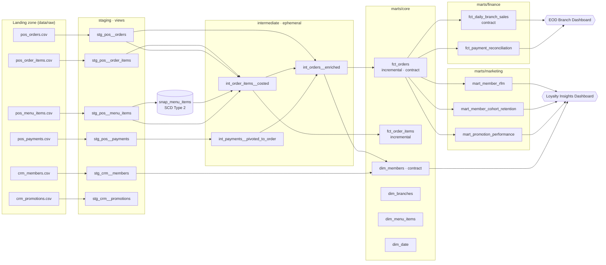

# Hoshi Kitchen — Restaurant Analytics Warehouse (dbt + DuckDB)

[](https://github.com/Sushma-66/restaurant-analytics-dbt/actions/workflows/dbt_ci.yml)


An end-to-end analytics engineering project for a (fictional) five-branch UK
Japanese restaurant group. Nightly **POS** and **loyalty-CRM** exports land as
messy CSVs; dbt turns them into tested, documented, contract-enforced tables
that power an end-of-day (EOD) branch dashboard and loyalty/promotion analysis.

The business problems are modelled on real restaurant operations work —
replacing a manual nightly EOD report, reconciling the till, and answering
*"does our 50% Sushi Club discount actually pay for itself?"* — using fully
synthetic data so the repo can be public.

> **Runs anywhere in ~2 minutes.** DuckDB is an in-process warehouse, so there is
> no cloud account, no credentials and no cost. The same models port to
> Snowflake / BigQuery / Databricks by changing `profiles.yml`.

---

## Architecture



| Layer | Materialisation | Rules |
|---|---|---|
| **sources** | external files, read in place | Every column lands as `VARCHAR` so a bad value never breaks ingestion. Freshness checks on `_loaded_at`. |
| **staging** | `view` | One model per source table. Rename, cast, clean, de-duplicate. No business logic, no joins (except lookup seeds). |
| **snapshots** | SCD2 table | `snap_menu_items` keeps every historical menu price — the POS only exports today's. |
| **intermediate** | `ephemeral` | Re-usable logic: point-in-time costing, payment pivots, order enrichment. |
| **marts** | `table` / `incremental` | Business-facing facts & dims, grouped by domain (`core`, `finance`, `marketing`) with owners and access levels. |

---

## What this project demonstrates

| Data engineering practice | Where |
|---|---|
| Layered modelling (staging → intermediate → marts), naming conventions | `models/` |
| Reading raw files directly from a landing zone (no copy step) | `models/staging/*/_*__sources.yml` |
| Messy-data handling: currency strings, case drift, duplicate re-exports | `stg_pos__orders.sql`, `macros/utils/parse_money.sql` |
| **Incremental models** with a late-arriving-data look-back window | `fct_orders.sql`, `fct_order_items.sql` |
| **SCD Type 2 snapshot** + point-in-time join | `snapshots/snap_menu_items.yml`, `int_order_items__costed.sql` |
| **Model contracts** (enforced column names & types) + PK constraints | `_core__models.yml`, `_finance__models.yml` |
| **Unit tests** (dbt 1.8+) on parsing, GDPR consent logic and RFM scoring | `tests/unit/_unit_tests.yml` |
| Generic, custom-generic and singular **data tests** (99 total) | model YAML, `macros/tests/`, `tests/singular/` |
| Warn-vs-error thresholds for a known real-world issue (till discrepancies) | `payments_reconcile_to_order_totals` |
| Seeds for reference data & label mapping | `seeds/` |
| Custom macros (env-aware schemas, VAT, money parsing) | `macros/utils/` |
| PII handling — raw email never reaches marts, only a hash | `dim_members.sql` |
| Groups, owners, access levels and **exposures** (downstream dashboards) | `_groups.yml`, `_exposures.yml` |
| Documentation with doc blocks, persisted to the warehouse | `docs/overview.md` |
| Dev / CI / prod targets with isolated schemas | `profiles.yml`, `generate_schema_name.sql` |
| **CI/CD** — lint → build → idempotency check → docs artefact | `.github/workflows/dbt_ci.yml` |
| SQL linting (SQLFluff) + pre-commit hooks | `.sqlfluff`, `.pre-commit-config.yaml` |

---

## Quickstart

Requires **Python 3.10+** and `make` (on Windows, run the commands inside each Makefile target by hand, or use Git Bash).

```bash
git clone https://github.com/Sushma-66/restaurant-analytics-dbt.git
cd restaurant-analytics-dbt

python -m venv .venv
source .venv/bin/activate          # Windows: .venv\Scripts\activate

make install                       # pip install -r requirements.txt + pre-commit
make data                          # generate ~125k orders of synthetic raw data (≈45s)
make build                         # dbt deps + seed + snapshot + run + test
make serve-docs                    # lineage graph & docs at http://localhost:8080
```

Without `make`:

```bash
pip install -r requirements.txt
python scripts/generate_raw_data.py
export DBT_PROFILES_DIR=.          # Windows PowerShell: $env:DBT_PROFILES_DIR="."
dbt deps
dbt build
```

Expected result:

```
Done. PASS=121 WARN=1 ERROR=0 SKIP=0 TOTAL=124
```

The single **WARN is intentional**: the generator records a handful of cash
payments short, exactly like a real till. `payments_reconcile_to_order_totals`
warns above 0 mismatches and only fails the build above 500, and
`fct_payment_reconciliation` surfaces those days for the branch manager.

### Explore the results

```bash
python -c "import duckdb; duckdb.connect('hoshi_dev.duckdb').sql('select * from dev_analyst_finance.fct_daily_branch_sales order by order_date desc limit 10').show()"
```

Or open `hoshi_dev.duckdb` in [DBeaver](https://dbeaver.io/) / the DuckDB CLI, or connect Power BI via the DuckDB ODBC driver.

### Demo the SCD2 snapshot

```bash
python scripts/simulate_menu_price_change.py --skus RAM-001 SID-002 --pct 5
dbt snapshot
# snap_menu_items now holds the old price (closed, dbt_valid_to set) and the new one (current)
```

---

## Project structure

```
.
├── .github/workflows/dbt_ci.yml   # CI: lint → build → incremental re-run → docs
├── analyses/                      # ad-hoc SQL compiled by dbt (not materialised)
├── data/raw/                      # landing zone (generated, git-ignored)
├── docs/overview.md               # doc blocks + docs-site homepage
├── macros/
│   ├── tests/                     # custom generic tests
│   └── utils/                     # schema naming, money parsing, VAT
├── models/
│   ├── staging/{pos,crm}/         # sources + stg_ models
│   ├── intermediate/              # int_ models (ephemeral)
│   └── marts/{core,finance,marketing}/
├── scripts/                       # synthetic data generator, snapshot demo
├── seeds/                         # branches, payment-label mapping
├── snapshots/                     # SCD2 menu history
├── tests/
│   ├── singular/                  # bespoke SQL assertions
│   └── unit/                      # dbt unit tests
├── dbt_project.yml
├── profiles.yml                   # DuckDB - no secrets, safe to commit
├── packages.yml                   # dbt_utils
├── Makefile
└── requirements.txt
```

---

## Key models

| Model | Grain | Answers |
|---|---|---|
| `fct_orders` | order | Every sale with VAT split, cost, margin, tender breakdown. |
| `fct_daily_branch_sales` | branch × day | The EOD report: sales, covers, spend per head, discount rate, tender mix, **same day last week**. |
| `fct_payment_reconciliation` | branch × day | Expected vs actual takings — where is the till short? |
| `mart_member_rfm` | member | Champions / Loyal / At Risk / Lost segments for CRM targeting. |
| `mart_member_cohort_retention` | cohort month × months since first order | Are newer members as sticky as older ones? |
| `mart_promotion_performance` | promo × month | Discount cost vs gross profit, and % of members returning at **full price** within 30 days. |

---

## Testing strategy

* **Sources** — `unique` / `not_null` on natural keys before anything is built.
* **Staging** — `accepted_values` on every enum, `relationships` to catch orphan keys,
  non-negative money, and a new POS payment label that isn't in the mapping seed fails `not_null`.
* **Marts** — contracts guarantee schema; `expression_is_true` checks arithmetic
  (`total = gross − discount + service`); a singular test proves the daily summary
  ties back to the order fact **to the penny**.
* **Unit tests** — logic tested on hand-written fixtures, independent of data:
  money parsing & de-dup, GDPR-safe consent defaults, RFM quintile assignment.
* **Failures are stored** (`+store_failures: true`) in a `test_failures` schema so
  failing rows can be inspected, not just counted.

---

## Environments

| Target | Schema naming | Use |
|---|---|---|
| `dev` (default) | `dev_<user>_core`, `dev_<user>_finance` … | Local development — each developer isolated |
| `ci` | `ci_core` … | GitHub Actions |
| `prod` | `core`, `finance`, `marketing` | Production — clean names via `generate_schema_name` |

```bash
dbt build --target prod
dbt build --vars '{raw_data_path: "s3://my-bucket/landing"}'   # repoint the landing zone
```

---

## Conventions

* Model prefixes: `stg_<source>__<entity>`, `int_<entity>__<verb>`, `fct_`, `dim_`, `mart_`.
* Every model has a YAML entry with a description; every primary key has `unique` + `not_null`.
* Money is `DECIMAL`, never `FLOAT`. Amounts are VAT-inclusive unless the column ends `_ex_vat`.
* CTEs: import CTEs first, one logical step per CTE, final `select` from a named CTE.
* SQL is lower-case and linted by SQLFluff in pre-commit and CI.

---

## About the data

All data is synthetic and generated by `scripts/generate_raw_data.py`
(deterministic with `--seed`). It simulates 21 months of trading across five
branches with weekly and seasonal patterns, branch openings, price rises,
promotions, split bills, voids, refunds, duplicate re-exports and till
discrepancies. "Hoshi Kitchen" is a fictional brand.

## License

MIT
